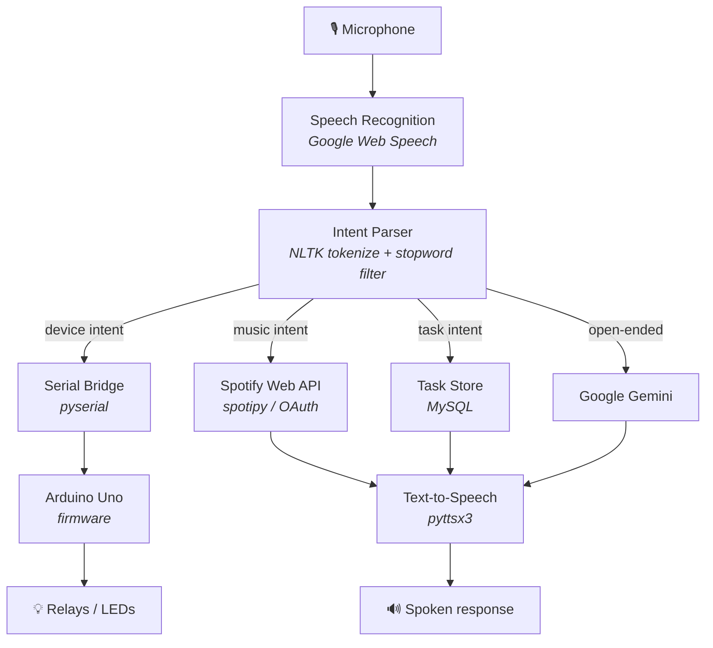

<div align="center">

# HomeSense

**A voice-first home automation assistant that turns natural speech into physical actions.**

Speak to your room. HomeSense hears you, understands what you meant, and drives the hardware — no app, no buttons, no wake-word hardware.

[](https://www.python.org/)
[](https://www.arduino.cc/)
[](https://ai.google.dev/)
[](https://developer.spotify.com/)
[](https://www.mysql.com/)
[](LICENSE)

**Showcased at GDG DevJams 2024 — Gravitas, VIT Vellore**

</div>

---

## Table of Contents

- [Overview](#overview)
- [Highlights](#highlights)
- [Architecture](#architecture)
- [How a Command Flows](#how-a-command-flows)
- [Tech Stack](#tech-stack)
- [Hardware](#hardware)
- [Getting Started](#getting-started)
- [Configuration](#configuration)
- [Usage](#usage)
- [Command Reference](#command-reference)
- [Serial Protocol](#serial-protocol)
- [Project Structure](#project-structure)
- [Troubleshooting](#troubleshooting)
- [Roadmap](#roadmap)
- [Contributing](#contributing)
- [Security](#security)
- [License](#license)
- [Author](#author)

---

## Overview

Most "smart home" setups are really just remote controls with extra steps — you still open an app and still tap a switch. HomeSense removes that layer entirely.

It runs a continuous listening loop on your machine, transcribes what you say, classifies the intent locally with NLTK, and routes it to the right handler: an opcode down the serial line to an Arduino for anything physical, the Spotify Web API for music, MySQL for task tracking, or Google Gemini for everything that's just a question. Responses come back as synthesized speech.

The result is a single conversational surface over hardware, cloud services, and a local database — built to be read, extended, and rewired for whatever you have plugged in.

---

## Highlights

| | |
|---|---|
| **Always-on wake loop** | Idles on a low-cost listener, wakes on `wake up`, sleeps on `sleep` — no polling the mic at full tilt. |
| **Local intent classification** | Tokenization and stop-word filtering with NLTK resolve device commands on-device, so lights never wait on a network round-trip. |
| **Graceful LLM fallback** | Anything that isn't a known intent goes to Gemini, so the assistant answers instead of failing. |
| **Deterministic hardware protocol** | A flat single-byte opcode map between host and firmware — trivial to debug with a serial monitor, trivial to extend. |
| **Real persistence** | Tasks live in MySQL with a date-indexed schema, not an in-memory list that dies with the process. |
| **Zero secrets in tree** | All credentials load from a git-ignored `creds.py`; the repo ships a template, never a key. |

---

## Architecture



The design keeps one rule: **anything with a physical consequence resolves locally.** Cloud services are only ever in the path for things that are inherently remote — music catalogs and open-ended questions. Your lights work whether or not your Wi-Fi does.

---

## How a Command Flows

Take `"turn on light two"`:

| Stage | What happens | Result |
|---|---|---|
| 1. Capture | `recognizer.listen()` with a 3s timeout and 5s phrase cap | raw audio |
| 2. Transcribe | Google Web Speech, `en-IN` | `"turn on light two"` |
| 3. Tokenize | `word_tokenize` → stop-word filter (with `on`/`off`/`all` deliberately preserved) | `['turn', 'light', 'two']` |
| 4. Classify | `light` present + `on` present + `two` present | intent = `light_2 : ON` |
| 5. Encode | opcode lookup | `3` |
| 6. Transmit | `serial.write(b"3")` at 9600 baud | byte on the wire |
| 7. Actuate | firmware `readString().toInt()` → `digitalWrite(pin2, HIGH)` | 💡 |

Note step 3: standard English stop-word lists throw away `on`, `off`, and `all` — which happen to be the three most load-bearing words in a home automation command. HomeSense removes them from the stop-word set before filtering. It's a one-line detail that the whole device path depends on.

---

## Tech Stack

| Layer | Technology |
|---|---|
| Speech-to-text | `SpeechRecognition` (Google Web Speech API) |
| Text-to-speech | `pyttsx3` (offline, SAPI5 / NSSpeech / eSpeak) |
| NLP | `NLTK` — `punkt` tokenizer, English stop-word corpus |
| Generative AI | Google Gemini via `google-generativeai` |
| Music | Spotify Web API via `spotipy` (OAuth 2.0 Authorization Code flow) |
| Persistence | MySQL 8 via `mysql-connector-python` |
| Host ↔ device | `pyserial` over USB CDC, 9600 baud |
| Firmware | C++ (Arduino) on ATmega328P |

---

## Hardware

**Bill of materials**

| Component | Qty | Notes |
|---|---|---|
| Arduino Uno (or any ATmega328P board) | 1 | Any board with USB serial works |
| LEDs *(or relay module)* | 3 | Swap LEDs for a 3-channel relay to drive mains loads |
| Resistors, 220 Ω | 3 | One per LED; omit if using relays |
| Breadboard + jumper wires | 1 set | |
| USB Type-B cable | 1 | Data cable — charge-only cables will not enumerate |

**Wiring**

| Channel | Arduino pin | Connection |
|---|---|---|
| Light 1 | D12 | pin → 220 Ω → LED anode; cathode → GND |
| Light 2 | D11 | pin → 220 Ω → LED anode; cathode → GND |
| Light 3 | D10 | pin → 220 Ω → LED anode; cathode → GND |

```
Arduino Uno
  D12 ──[220Ω]──▶|── GND     (Light 1)
  D11 ──[220Ω]──▶|── GND     (Light 2)
  D10 ──[220Ω]──▶|── GND     (Light 3)
```

On boot the firmware pulses all three channels HIGH for one second, then LOW — a self-test so you know your wiring is right before you say a word.

> [!WARNING]
> Driving mains voltage requires an opto-isolated relay module and appropriate care. Do not connect AC loads directly to GPIO pins.

---

## Getting Started

### Prerequisites

- Python 3.9 or newer
- MySQL Server 8.0+
- Arduino IDE 2.x
- A microphone
- API credentials: [Google Gemini](https://aistudio.google.com/app/apikey) and [Spotify](https://developer.spotify.com/dashboard)

### 1. Clone and install

```bash
git clone https://github.com/Divyakush2006/HomeSense.git
cd HomeSense

python -m venv .venv
# Windows
.venv\Scripts\activate
# macOS / Linux
source .venv/bin/activate

pip install -r requirements.txt
python download_nltk_data.py
```

> **PyAudio on Windows** — if `pip` fails to build it, install a prebuilt wheel instead:
> `pip install pipwin && pipwin install pyaudio`

### 2. Provision the database

```bash
mysql -u root -p < schema.sql
```

### 3. Configure credentials

```bash
# Windows
copy creds.example.py creds.py
# macOS / Linux
cp creds.example.py creds.py
```

Open `creds.py` and fill in your keys. It is git-ignored — it will not be committed.

In the Spotify dashboard, add `http://localhost:8888/callback` to your app's **Redirect URIs**, matching `redirect_url` in `creds.py`.

### 4. Flash the firmware

1. Open `firmware/homesense_controller/homesense_controller.ino` in the Arduino IDE.
2. Select **Tools → Board → Arduino Uno** and the correct port.
3. Upload. All three LEDs should flash once — that's the self-test.
4. **Close the Serial Monitor.** It holds the port and will block the Python process.

### 5. Run

```bash
python main.py
```

---

## Configuration

| Variable | Default | Purpose |
|---|---|---|
| `HOMESENSE_SERIAL_PORT` | `COM10` | Serial port of the Arduino |
| `HOMESENSE_BAUDRATE` | `9600` | Must match `Serial.begin()` in firmware |

```bash
# Windows (PowerShell)
$env:HOMESENSE_SERIAL_PORT = "COM3"

# macOS / Linux
export HOMESENSE_SERIAL_PORT=/dev/ttyACM0
```

Find your port under **Tools → Port** in the Arduino IDE, or run `python -m serial.tools.list_ports`.

---

## Usage

On launch HomeSense greets you with the time of day and enters its active loop. Speak naturally.

```
Assistant: Good evening
Assistant: Now the time is 07:42 PM
Assistant: Listening....

User:  turn on light one
       💡 D12 → HIGH

User:  play bohemian rhapsody
       ▶ Playing Bohemian Rhapsody by Queen

User:  what is the boiling point of water at high altitude
Assistant: water boils at a lower temperature at high altitude because
           atmospheric pressure decreases with elevation...

User:  sleep
       ⏸ idle — say "wake up" to resume

User:  wake up
Assistant: Good evening
Assistant: Listening....
```

---

## Command Reference

| Say | Action |
|---|---|
| `turn on light one` / `two` / `three` | Energize that channel |
| `turn off light one` / `two` / `three` | De-energize that channel |
| `turn on all lights` | All channels HIGH |
| `turn off all lights` | All channels LOW |
| `play <song or artist>` | Search Spotify and open the top result |
| *any other phrase* | Routed to Gemini, answered aloud |
| `sleep` / `exit` | Drop to the low-cost wake listener |
| `wake up` | Resume the active loop |
| `terminate` / `end` | Shut down the process |

Both digits and words are accepted — `light 2` and `light two` parse identically.

---

## Serial Protocol

The host↔device contract is one ASCII digit per command. Deliberately flat: you can drive the whole rig from a serial monitor with no Python running.

| Opcode | Pin | Action |
|:---:|:---:|---|
| `1` | D12 | Light 1 → ON |
| `2` | D12 | Light 1 → OFF |
| `3` | D11 | Light 2 → ON |
| `4` | D11 | Light 2 → OFF |
| `5` | D10 | Light 3 → ON |
| `6` | D10 | Light 3 → OFF |

**Adding a channel:** append a `pinMode`/`digitalWrite` pair in the firmware, add the opcodes to the `if/else` chain, then extend the intent parser in `main.py`. Two files, no framework.

---

## Project Structure

```
HomeSense/
├── main.py                  # Entry point — wake loop, intent parsing, routing
├── serial_bridge.py         # pyserial transport to the Arduino
├── todo.py                  # MySQL-backed task store
├── download_nltk_data.py    # One-time NLTK corpus download
├── creds.example.py         # Credential template (copy → creds.py)
├── schema.sql               # Database schema
├── requirements.txt
├── firmware/
│   └── homesense_controller/
│       └── homesense_controller.ino   # Arduino sketch
└── docs/
```

---

## Troubleshooting

<details>
<summary><b>SerialException: could not open port</b></summary>

<br>

Three usual causes, in order of likelihood:

1. **The Arduino IDE Serial Monitor is open.** It holds an exclusive lock. Close it.
2. **Wrong port.** Check `python -m serial.tools.list_ports` and set `HOMESENSE_SERIAL_PORT`.
3. **Charge-only USB cable.** The board powers up but never enumerates as a serial device. Swap for a data cable.

</details>

<details>
<summary><b>The assistant never hears me</b></summary>

<br>

Confirm the mic is the system default input, then check the ambient noise floor — `listen()` uses a 3-second timeout, so a noisy room can consume the window before you finish speaking. Verify your device is visible to PyAudio:

```python
import speech_recognition as sr
print(sr.Microphone.list_microphone_names())
```

</details>

<details>
<summary><b>LookupError: Resource punkt not found</b></summary>

<br>

The NLTK corpora were not downloaded. Run `python download_nltk_data.py` inside the activated virtual environment — installing into a different interpreter than the one running `main.py` is the common cause.

</details>

<details>
<summary><b>Spotify opens the browser every run</b></summary>

<br>

`spotipy` caches the OAuth token in a `.cache` file next to `main.py`. It is git-ignored by design. If the browser opens each time, the working directory is changing between runs, or the redirect URI in `creds.py` does not exactly match the one registered in the Spotify dashboard — including the trailing path.

</details>

<details>
<summary><b>Lights respond to the wrong command</b></summary>

<br>

Verify the opcode map in `serial_bridge.py` matches the `if/else` chain in the firmware. They are two independent sources of truth, and drift between them is the most common cause of off-by-one channel behaviour.

</details>

---

## Roadmap

- [ ] Ambient sensing — DHT11 temperature/humidity telemetry surfaced on request
- [ ] Fire and gas detection with proactive spoken alerts
- [ ] Rule engine — schedule and condition-triggered automations
- [ ] Replace the keyword classifier with an intent model for free-form phrasing
- [ ] Migrate the serial link to ESP32 over Wi-Fi/MQTT for untethered operation
- [ ] Web dashboard for device state and task history
- [ ] Multi-room device addressing

---

## Contributing

Contributions are welcome.

1. Fork the repository
2. Create a feature branch — `git checkout -b feature/your-feature`
3. Commit your changes — `git commit -m "Add your feature"`
4. Push the branch — `git push origin feature/your-feature`
5. Open a Pull Request

Please keep the opcode map in `serial_bridge.py` and the firmware switch in sync in the same commit, and never commit `creds.py`.

---

## Security

Please report vulnerabilities privately as described in the [security policy](https://github.com/Divyakush2006/.github/blob/main/SECURITY.md). Do not open a public issue.

## License

Distributed under the MIT License. See [`LICENSE`](LICENSE) for details.

---

## Author

**Divyakush Punjabi**

[](https://github.com/Divyakush2006)
[](mailto:divyakushpunjabi@gmail.com)

<div align="center">
<br>
<sub>Built for <b>GDG DevJams 2024</b> · Gravitas · VIT Vellore</sub>
<br><br>
<sub>If this project is useful to you, consider leaving a ⭐</sub>
</div>
